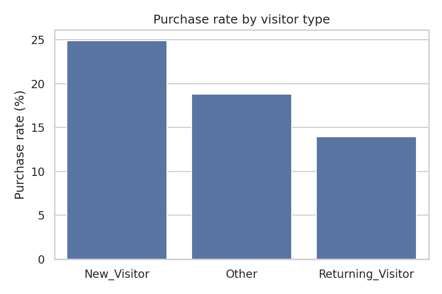
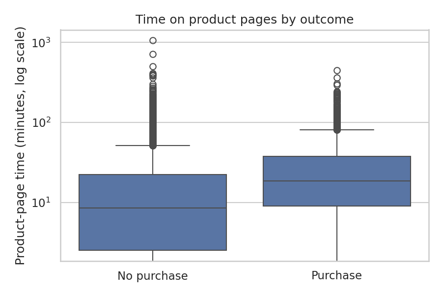
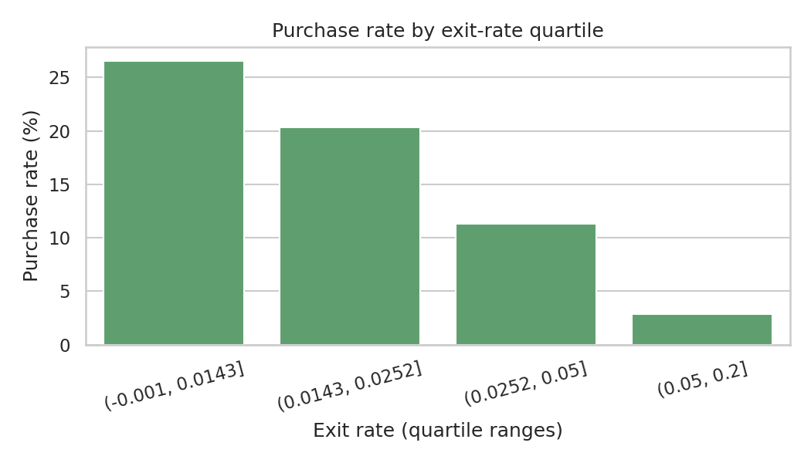
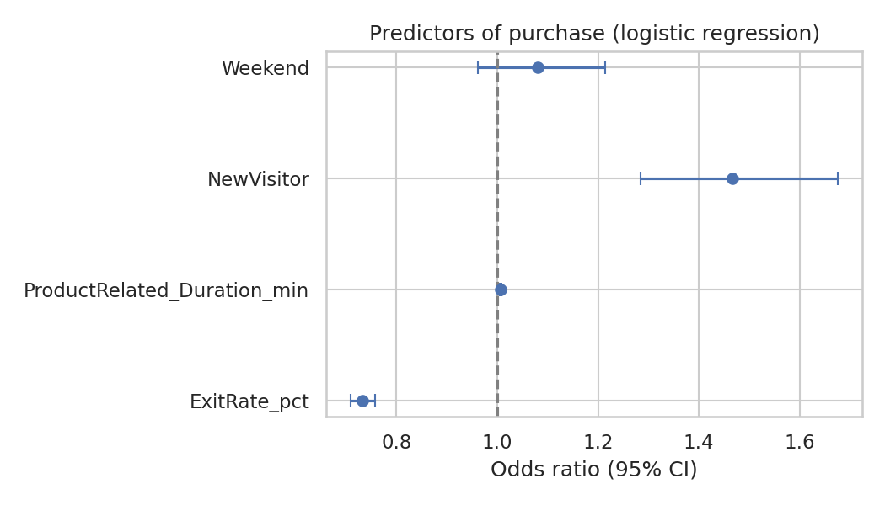

# Behavioural Drivers of Online Purchase Sessions

**A secondary data analysis of e-commerce browsing behaviour (Python)**

Author: Bhakta Prahalada · BA (Hons) Psychology, IGNOU

## Summary

This project asks which user-behaviour and friction signals are associated with whether an online shopping session ends in a purchase. I analysed 12,330 publicly available e-commerce sessions using chi-square, Mann-Whitney U and logistic regression, and interpret the findings from a UX research perspective. This is a secondary analysis of existing data; I did not collect the data myself.

## Research question and hypotheses

**RQ:** What visitor-behaviour and page-friction signals are associated with a session ending in a purchase?

- **H1:** New and returning visitors differ in purchase rate.
- **H2:** Time spent on product pages differs between sessions that end in a purchase and sessions that do not.
- **H3:** Higher page exit and bounce rates are associated with lower odds of purchase.

## Data

- **Source:** Online Shoppers Purchasing Intention Dataset, UCI Machine Learning Repository (Sakar & Kastro, 2018). https://doi.org/10.24432/C5F88Q
- **Licence:** CC BY 4.0
- **Size:** 12,330 sessions, 18 variables. Per the dataset documentation, each session belongs to a different user over a one-year period.
- **Key variables:** `Revenue` (session ended in purchase), `VisitorType` (new / returning / other), `ProductRelated_Duration` (time on product pages), `BounceRates` and `ExitRates` (Google Analytics page metrics), `Weekend`.

## Methods

- **Cleaning:** No missing values were present. 125 duplicate rows (about 1%) were identified and retained, because each row represents a distinct session. Time variables were converted from seconds to minutes. `Revenue` and `Weekend` were coded 0/1.
- **H1:** Chi-square test of independence on new vs returning visitors. The 85 sessions classed as "Other" were excluded from this test because the group is very small. Effect size: Cramér's V.
- **H2:** Mann-Whitney U test, because product-page time was strongly right-skewed (mean about 19.9 min vs median about 10.0 min). Effect size: rank-biserial r.
- **H3:** Logistic regression with purchase as the outcome, adjusting for product-page time, new-visitor status and weekend. Exit rate and bounce rate were highly correlated (r = .91), so they were modelled in two separate models. Rates were expressed per percentage point and time per minute. In the model, "new visitor" is compared against all other sessions (returning and other visitors combined).
- **Excluded variable:** `PageValues` was not used as a predictor. It is a Google Analytics metric partly derived from transactions, so it is too close to the outcome itself.
- **Tools:** Python (pandas, SciPy, statsmodels, matplotlib, seaborn), run in Google Colab.

## Results

### H1: New visitors purchased more often than returning visitors

24.9% of new visitors (422 of 1,694) ended in a purchase, compared with 13.9% of returning visitors (1,470 of 10,551), χ²(1, N = 12,245) = 133.84, p < .001, Cramér's V = 0.11 (small effect).

### H2: Purchasing sessions spent longer on product pages

Sessions with a purchase had a higher median time on product-related pages (18.5 min) than sessions without one (8.5 min), Mann-Whitney U = 13,382,713, p < .001, rank-biserial r = 0.35 (medium effect).

### H3: Higher exit and bounce rates were associated with lower odds of purchase

| Predictor | Exit-rate model, OR (95% CI) | Bounce-rate model, OR (95% CI) |
|---|---|---|
| Exit or bounce rate (per +1 percentage point) | 0.73 [0.71, 0.76] | 0.75 [0.72, 0.79] |
| Product-page time (per extra minute) | 1.007 [1.006, 1.009] | 1.010 [1.009, 1.012] |
| New visitor (vs returning/other) | 1.47 [1.28, 1.68] | 1.82 [1.60, 2.07] |
| Weekend | 1.08 [0.96, 1.21], p = .19 | 1.13 [1.00, 1.26], p = .043 |

Each one-percentage-point rise in exit rate was associated with about 27% lower odds of purchase, and a one-point rise in bounce rate with about 25% lower odds, holding the other variables constant. Each additional 10 minutes on product pages was associated with roughly 7% to 11% higher odds, depending on the model. New visitors had higher odds of purchase in both models, although the size of that estimate varied between them. No consistent weekend effect was found.

Purchase rate also fell steadily across exit-rate quartiles (chart below).

## Design implications

Pages with high exit and bounce rates are the clearest signal of possible friction in this dataset, and sessions with more time on product pages were more likely to end in a purchase. A UX team could prioritise the highest-exit pages for follow-up qualitative research, such as usability testing, task-based observation or short interviews, to find out *why* visitors leave. The data shows where to look, but cannot explain the reason.

## Limitations

- **Association, not causation.** Longer product-page time may reflect purchase intent, comparison shopping or difficulty finding information; this data cannot tell these apart. The higher purchase rate among new visitors may reflect traffic sources or browsing patterns that are not observed here.
- **Page-level metrics.** Bounce and exit rates are Google Analytics metrics calculated per page, so they describe page performance rather than an individual user's decision.
- **Single retailer, session-level data only.** There is no user demographic, device-experience or intent information, so findings may not generalise.
- **Secondary data.** I did not design or collect this dataset, and could not check how sessions were recorded or classified.
- **Duplicates.** The 125 duplicate rows were retained; I did not run a sensitivity analysis without them.
- **Multiple tests.** Three hypotheses were tested without correction; with a sample this large, small effects reach statistical significance, so effect sizes matter more than p-values.
- **Model specification.** The new-visitor estimate differed between the exit-rate and bounce-rate models, so I treat it as direction-consistent rather than precise.

## Reproduce

1. Open `shoppers_analysis.ipynb` in Google Colab.
2. Run `!pip -q install ucimlrepo statsmodels` in the first cell.
3. Run the cells in order. The data downloads automatically from UCI.

## Citation

Sakar, C. O., & Kastro, Y. (2018). *Online Shoppers Purchasing Intention Dataset* [Dataset]. UCI Machine Learning Repository. https://doi.org/10.24432/C5F88Q
